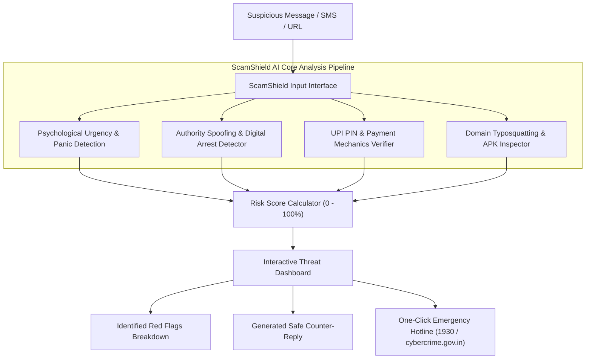

# 🛡️ ScamShield AI: Real-Time Fraud & Social Engineering Interceptor

> **Hackathon Prototype** | Next-Gen AI Defense Against Digital Arrests, Reverse UPI Traps, Smishing & Job Scams

[](#)
[-blue)](#)
[](#)

---

## 📌 1. The Real-World Problem Statement

Financial cyber fraud has evolved from basic Nigerian prince emails to **sophisticated psychological extortion** that costs global citizens **over $1.02 Trillion annually**:

1. **Digital Arrest & Police Extortion**: Scammers impersonate CBI, Mumbai Police, or Customs over WhatsApp/Skype video calls, falsely claiming illegal parcels or drug trafficking, placing victims under "digital arrest" and extorting lakhs of rupees.
2. **Reverse UPI / QR Code Scams**: Sellers on OLX or Facebook Marketplace are tricked into scanning a QR code or entering their 6-digit UPI PIN under the belief that PIN is needed to *receive* funds.
3. **Task & Telegram Investment Traps**: Victims are promised ₹3,000–₹8,000/day for liking YouTube videos, lured with small initial payouts, and then trapped in high-value non-withdrawable deposit pools.
4. **Smishing & Malicious APKs**: Fake courier alerts (India Post, FedEx) or Bank KYC warnings prompt users to install malicious `.apk` apps that intercept SMS OTPs in the background.

**The Fatal Flaw of Existing Solutions**:
Current spam blockers (Truecaller, Gmail filters) only check static blacklists and telephone numbers. They **cannot understand the psychological urgency, reverse UPI mechanics, or manipulative rhetoric** occurring inside encrypted messaging apps.

---

## 💡 2. The Solution: ScamShield AI

**ScamShield AI** is an intelligent, multi-vector threat analyzer designed to be embedded directly into messaging apps, keyboard extensions, or web dashboards.

### Core Capabilities:
- 🧠 **Psychological Urgency Profiling**: Detects artificial time windows ("within 15 minutes", "action will be taken today") designed to bypass rational thinking.
- 💳 **Payment Mechanics Validation**: Flags the fatal UPI flaw (*"Enter UPI PIN to receive money"*).
- 🔗 **Deep Domain & APK Inspector**: Uncovers typosquatted domains (`indiapost-tracking.support`), direct IP addresses, and remote-access `.apk` files.
- ⚖️ **Explainable AI (XAI)**: Demystifies scams with human-readable legal & technical facts (e.g., *"Digital arrest does not legally exist in Indian Law"*).
- 🛡️ **Actionable Defense Playbook & Counter-Replies**: Generates safe, de-escalation responses and links directly to the **1930 Cybercrime Helpline**.

---

## 🏗️ 3. Architecture & Data Flow



---

## 🚀 4. How to Run the Prototype in 10 Seconds

### Option A: Direct Browser Launch (Zero-Setup, Works Offline!)
Simply double-click or open `index.html` in any web browser:
```bash
# In your terminal or file explorer
start index.html
```

### Option B: Run with Python Backend API
Run the zero-dependency Python server:
```bash
python server.py
```
Then visit:
```
http://localhost:8080
```

---

## 🧪 5. Hackathon Judge Demo Test Cases

| Scenario | Category | Key Trigger Tested | Expected Score |
| :--- | :--- | :--- | :--- |
| **CBI Digital Arrest** | Authority Extortion | "Customs seized narcotics", "Digital Arrest", "15 mins" | **96% CRITICAL** |
| **YouTube Task Scam** | Pyramid / Part-time | "Like YouTube videos", "Earn ₹5000 daily", Telegram | **91% HIGH** |
| **OLX QR Code Reverse** | Payment Trap | "Enter UPI PIN to receive money", "Scan QR" | **94% CRITICAL** |
| **India Post Smishing** | URL Phishing | Unofficial `.support` domain, ₹25 delivery fee | **88% HIGH** |
| **SBI APK Suspension** | Malware Payload | Direct `.apk` download link, same-day account freeze | **98% CRITICAL** |
| **Legitimate Bank OTP** | False-Positive Test | Official bank alert with "NEVER share this OTP" warning | **8% SAFE** |

---

## 🎤 6. Winning 3-Minute Hackathon Pitch Script

> **Judge Hook (0:00 - 0:45)**:
> *"Judges, in the last 24 hours alone, innocent citizens lost crores to a scam that didn't even exist three years ago: 'Digital Arrest'. A fake CBI officer calls on Skype, induces panic, and victims transfer their life savings. Traditional spam filters completely fail because they only check phone numbers, not psychological manipulation."*
>
> **The Solution (0:45 - 1:30)**:
> *"That is why we built **ScamShield AI**. ScamShield is not a dumb keyword filter. It uses multi-vector AI analysis to dissect the psychological urgency, reverse UPI mechanics, and suspicious APK downloads in real-time."*
>
> **Live Demo (1:30 - 2:15)**:
> *(Click the 'Digital Arrest' preset)*
> *"Watch this: with one click, our engine flags that 'Digital arrest is legally fictitious', highlights the 15-minute panic window, and provides a safe de-escalation response and direct link to the 1930 cyber helpline. Even better, when tested against a legitimate bank OTP, it recognizes standard security notices without causing false panic."*
>
> **Market Impact & Future Scope (2:15 - 3:00)**:
> *"ScamShield operates with a privacy-first, on-device architecture suitable for WhatsApp bots, Android keyboard integrations, and banking apps. It protects the most vulnerable citizens—our elders and digital novices—before their money leaves the bank."*

---

## 🏆 7. Hackathon Judging Matrix Alignment

- **Innovation & Technical Depth**: Multi-vector heuristics combining psychological triggers, payment mechanics, and URL threat heuristics.
- **Real-World Impact**: Direct solution to India's and the world's fastest-growing cyber extortion crisis (Digital Arrest & UPI fraud).
- **Usability & UX**: One-click preset demos, animated circular risk meter, explainable red flags, and 1-click safe response generation.
- **Feasibility & Scalability**: Zero-dependency Python server + lightweight client-side offline execution.
